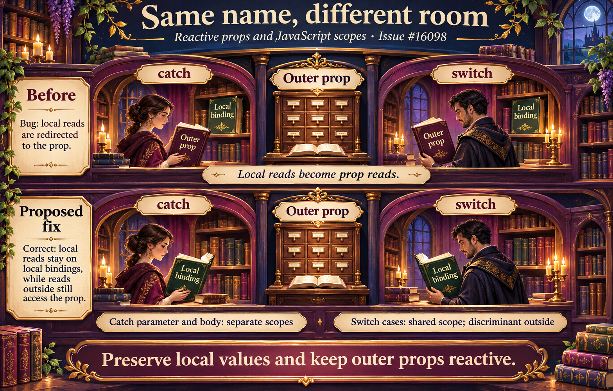

# Reactive props destructure rewrites shadowed catch and switch bindings

The SFC compiler rewrites destructured prop reads to preserve reactivity. Local catch pattern bindings and switch case bindings need their own JavaScript scopes so those reads keep resolving to the local variable. The proposed fix separates catch parameter/body scopes and activates the shared switch case scope after the discriminant.

[Issue #16098](https://github.com/vuejs/core/issues/16098) · [Runnable SFC Playground](https://play.vuejs.org/#eyJBcHAudnVlIjoiPHNjcmlwdCBzZXR1cD5cbmNvbnN0IHsgbWVzc2FnZSB9ID0gZGVmaW5lUHJvcHMoeyBtZXNzYWdlOiB7IGRlZmF1bHQ6ICdwcm9wJyB9IH0pXG5mdW5jdGlvbiBjYXVnaHQoKSB7XG4gIHRyeSB7IHRocm93IHsgbWVzc2FnZTogJ2NhdWdodCcgfSB9XG4gIGNhdGNoICh7IG1lc3NhZ2UgfSkgeyByZXR1cm4gbWVzc2FnZSB9XG59XG5mdW5jdGlvbiBzd2l0Y2hlZCgpIHtcbiAgc3dpdGNoICgwKSB7XG4gICAgY2FzZSAwOlxuICAgICAgY29uc3QgbWVzc2FnZSA9ICdjYXNlJ1xuICAgICAgcmV0dXJuIG1lc3NhZ2VcbiAgfVxufVxuPC9zY3JpcHQ+XG48dGVtcGxhdGU+XG4gIDxwPmNhdGNoOiB7eyBjYXVnaHQoKSB9fTwvcD5cbiAgPHA+c3dpdGNoOiB7eyBzd2l0Y2hlZCgpIH19PC9wPlxuPC90ZW1wbGF0ZT4iLCJfdmVyc2lvbiI6IjMuNS40NCJ9) · [SFC source](App.vue)

Generated with the native image_gen tool. [Exact prompt](prompt.txt). The diagrams describe proposed changes; the issues contain executable reproductions.

Visual theme: fantasy library. The illustrations use this metaphor to explain the same underlying behavior and proposed correction.

