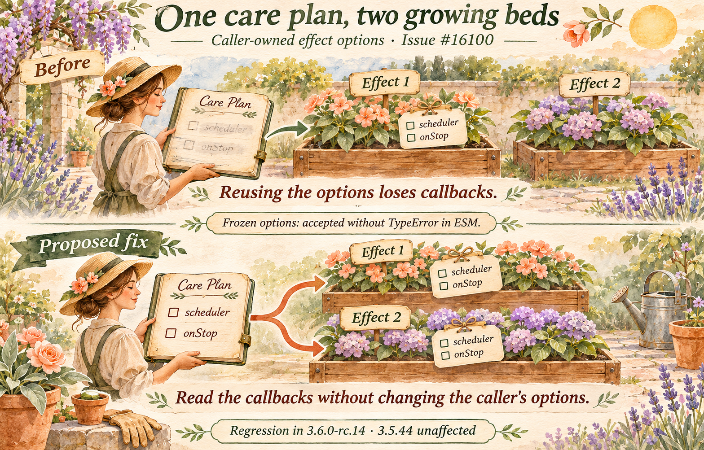

# effect() mutates shared options and rejects frozen options in the ESM build

The caller can pass one effect options object to more than one effect. The 3.6 prerelease clears the callback properties while constructing the first effect; later effects lose them, and frozen options throw in ESM. The proposed fix extracts the callbacks and forwards the remaining options without changing the input object.

[Issue #16100](https://github.com/vuejs/core/issues/16100) · [Runnable SFC Playground](https://play.vuejs.org/#eyJBcHAudnVlIjoiPHNjcmlwdCBzZXR1cD5cbmltcG9ydCB7IGVmZmVjdCwgcmVmLCBzdG9wIH0gZnJvbSAndnVlJ1xuXG5sZXQgc2NoZWR1bGVyQ2FsbHMgPSAwXG5sZXQgb25TdG9wQ2FsbHMgPSAwXG5sZXQgc2Vjb25kUnVucyA9IDBcbmNvbnN0IG9wdGlvbnMgPSB7XG4gIHNjaGVkdWxlcjogKCkgPT4gc2NoZWR1bGVyQ2FsbHMrKyxcbiAgb25TdG9wOiAoKSA9PiBvblN0b3BDYWxscysrLFxufVxuXG5jb25zdCBmaXJzdFNvdXJjZSA9IHJlZigwKVxuY29uc3Qgc2Vjb25kU291cmNlID0gcmVmKDApXG5jb25zdCBmaXJzdCA9IGVmZmVjdCgoKSA9PiBmaXJzdFNvdXJjZS52YWx1ZSwgb3B0aW9ucylcbmNvbnN0IHNlY29uZCA9IGVmZmVjdCgoKSA9PiB7XG4gIHNlY29uZFJ1bnMrK1xuICByZXR1cm4gc2Vjb25kU291cmNlLnZhbHVlXG59LCBvcHRpb25zKVxuXG5maXJzdFNvdXJjZS52YWx1ZSsrXG5zZWNvbmRTb3VyY2UudmFsdWUrK1xuc3RvcChmaXJzdClcbnN0b3Aoc2Vjb25kKVxuXG5sZXQgZnJvemVuRXJyb3IgPSAnbm9uZSdcbnRyeSB7XG4gIGNvbnN0IHJ1bm5lciA9IGVmZmVjdCgoKSA9PiB7fSwgT2JqZWN0LmZyZWV6ZSh7IG9uU3RvcDogKCkgPT4ge30gfSkpXG4gIHN0b3AocnVubmVyKVxufSBjYXRjaCAoZXJyb3IpIHtcbiAgZnJvemVuRXJyb3IgPSBgJHtlcnJvci5uYW1lfTogJHtlcnJvci5tZXNzYWdlfWBcbn1cblxuY29uc3QgcmVzdWx0ID0geyBzY2hlZHVsZXJDYWxscywgb25TdG9wQ2FsbHMsIHNlY29uZFJ1bnMsIGZyb3plbkVycm9yIH1cbjwvc2NyaXB0PlxuXG48dGVtcGxhdGU+XG4gIDxwcmUgaWQ9XCJyZXN1bHRcIj57eyBKU09OLnN0cmluZ2lmeShyZXN1bHQsIG51bGwsIDIpIH19PC9wcmU+XG48L3RlbXBsYXRlPiIsIl92ZXJzaW9uIjoiMy42LjAtcmMuMTQifQ==) · [SFC source](App.vue)

Generated with the native image_gen tool. [Exact prompt](prompt.txt). The diagrams describe proposed changes; the issues contain executable reproductions.

Visual theme: botanical garden. The illustrations use this metaphor to explain the same underlying behavior and proposed correction.

