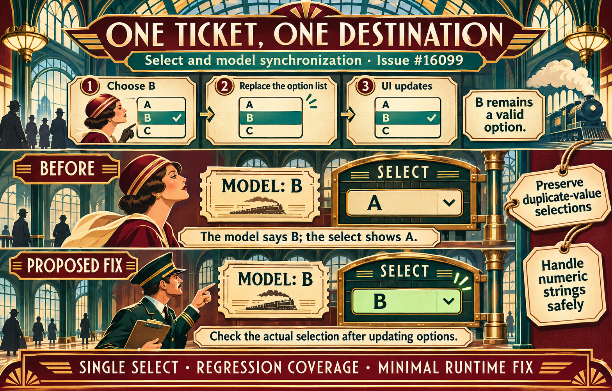

# Select displays a different value from v-model after replacing the selected option during change

A select change handler can replace the keyed option currently selected while the same value remains available. The browser may select another option, so an unchanged pending model cannot prove the DOM is still synchronized. The proposed fix checks the current option before skipping the normal synchronization for a single select.

[Issue #16099](https://github.com/vuejs/core/issues/16099) · [Runnable SFC Playground](https://play.vuejs.org/#eyJBcHAudnVlIjoiPHNjcmlwdCBzZXR1cD5cbmltcG9ydCB7IHJlZiB9IGZyb20gJ3Z1ZSdcblxuY29uc3Qgc2VsZWN0ZWQgPSByZWYoJ2EnKVxuY29uc3Qgb3B0aW9ucyA9IHJlZihbXG4gIHsgaWQ6IDEsIHZhbHVlOiAnYScgfSxcbiAgeyBpZDogMiwgdmFsdWU6ICdiJyB9LFxuXSlcblxuZnVuY3Rpb24gcmVmcmVzaE9wdGlvbnMoKSB7XG4gIG9wdGlvbnMudmFsdWUgPSBbXG4gICAgeyBpZDogMSwgdmFsdWU6ICdhJyB9LFxuICAgIHsgaWQ6IDMsIHZhbHVlOiAnYicgfSxcbiAgXVxufVxuPC9zY3JpcHQ+XG5cbjx0ZW1wbGF0ZT5cbiAgPHA+TW9kZWw6IHt7IHNlbGVjdGVkIH19PC9wPlxuICA8c2VsZWN0IHYtbW9kZWw9XCJzZWxlY3RlZFwiIEBjaGFuZ2U9XCJyZWZyZXNoT3B0aW9uc1wiPlxuICAgIDxvcHRpb24gdi1mb3I9XCJvcHRpb24gaW4gb3B0aW9uc1wiIDprZXk9XCJvcHRpb24uaWRcIiA6dmFsdWU9XCJvcHRpb24udmFsdWVcIj5cbiAgICAgIHt7IG9wdGlvbi52YWx1ZSB9fVxuICAgIDwvb3B0aW9uPlxuICA8L3NlbGVjdD5cbjwvdGVtcGxhdGU+IiwiX3ZlcnNpb24iOiIzLjUuNDQifQ==) · [SFC source](App.vue)

Generated with the native image_gen tool. [Exact prompt](prompt.txt). The diagrams describe proposed changes; the issues contain executable reproductions.

Visual theme: Art Deco railway station. The illustrations use this metaphor to explain the same underlying behavior and proposed correction.

