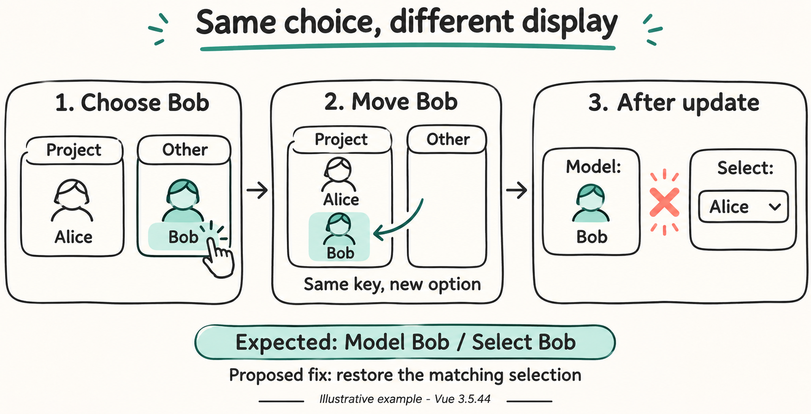

# Same choice, different display

Illustration for [Vue issue #16099](https://github.com/vuejs/core/issues/16099) and [PR #16102](https://github.com/vuejs/core/pull/16102). The runnable example is [App.vue](App.vue).

## How it works

The model stores the selected person's ID. A native select displays people in two groups: Project members and Other people.

Choosing Bob immediately adds him to the project. His key and value stay `bob`, but moving to another `optgroup` recreates his option element. Keys identify children within their current parent.

## The problem

In the Vue 3.5.44 reproduction, the model remembers Bob while the browser displays Alice after rebuilding the options. A matching model value does not guarantee that the browser kept the selected option.

## The proposed fix

Remember the user's selection during the change. If rebuilding the list replaces that selection, restore a matching option. Bob should appear in both the model and the select. Current implementation and validation details are in the PR.

## Evidence limits

This is a constructed example, not a screenshot or an independently documented production incident. The drawing does not claim the fix has shipped. Previous browser assertions passed, but browser shutdown required forced cleanup; the PR records that limitation.

## Generation

- Tool: native GPT Images through `image_gen`.
- Direction: minimal line drawings, a light background, simple avatars, short labels, and two accent colors.
- The previous image supplied the factual story; its visual style was replaced.
- Prompt helper: `python scripts/pr_infographic_prompt.py --title ... --summary ... --docs ... --json`, run directly with Python from `C:/Users/Nitro/Projects/t3code-publication`.
- Final image: [infographic.png](infographic.png).
- Exact generation prompt: [prompt.txt](prompt.txt).
- Helper output: [prompt_seed.json](prompt_seed.json).
